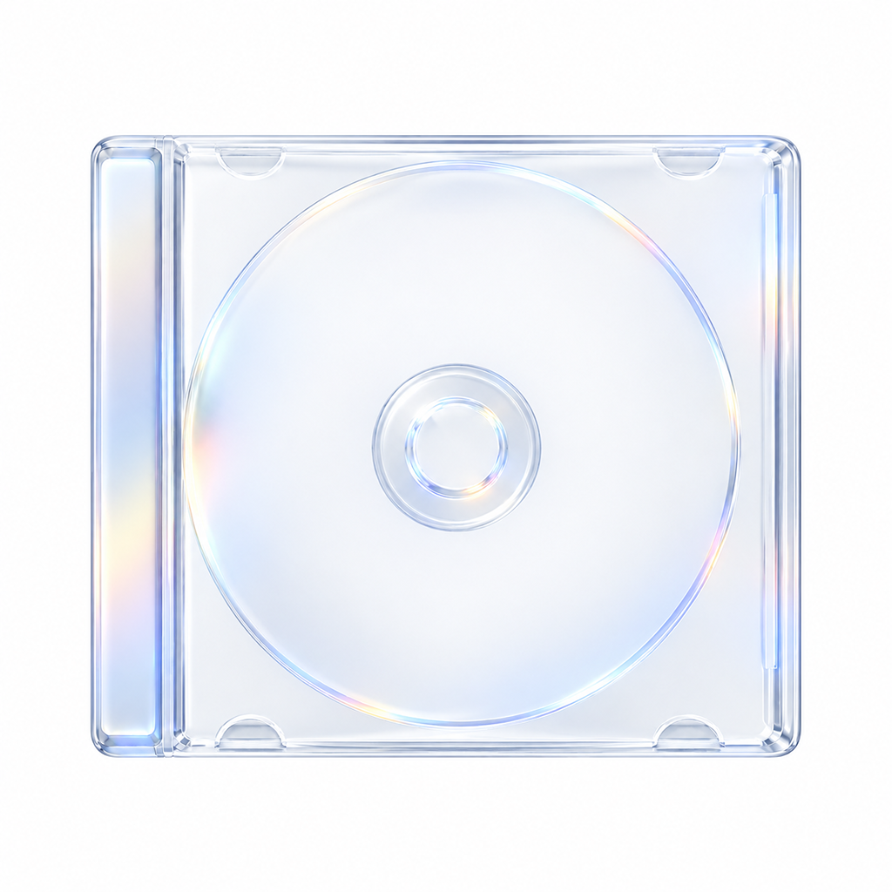

  

<a href="https://github.com/emilianooowo/Discs-Releases/releases/latest/download/Discs.zip"><strong>Download Discs 3.6.1</strong></a>

<h1 align="center">Discs</h1>

<h3 align="center">Your physical music collection, beautifully organized.</h3>

  A native macOS app to catalog, organize, and rediscover your physical CD collection. 
  Built with SwiftUI and SwiftData.

  
  
  

---

## Overview

**Discs** brings your physical music collection into a clean, thoughtful digital space. Explore your albums, keep track of your collection, and revisit the music that matters to you.

Designed for collectors. Built for macOS. Private by default.

## Discs 3.6.1

- What’s New now shows the 3.6 features and a simplified history of major versions.

## What’s new in 3.6.0

- Search CD editions by artist, title, or barcode and review suggested artwork, genre, release date, and tracks before saving.
- Search lyrics in your collection or online with more precise matching and album artwork.
- Add missing lyrics from CD details or Now Playing.
- Open CD search with Command-Shift-N.

## What’s new in 3.5.0

- Personalize a local profile with your name and photo.
- See collection totals, recent albums, and all-time favorites.
- Keep your profile in library backups and show artwork using your shelf style and zoom.
- Filter listening history by month, year, or all time.

## Version history (source only)

### 3.6.2

- Prepared standard-size artwork search and selection for Discs 3.7.
- Historical release without downloadable app files; 3.6.1 remains the latest available download.

### 3.4.6

- Return to All Artists or All Genres when the sidebar selection is cleared.
- This historical release has no downloadable app; 3.6.1 is the latest available download.

### 3.4.5

- Filter Listen History by month, year, or all time, including rankings and full history.
- This historical release has no downloadable app; 3.6.1 is the latest available download.

## What’s new in 3.4.0

- Edit shared CD fields with clear mixed values and pickers for tags, locations, editions, and imported countries.
- See consistent domestic, imported, unknown-country, and unset labels across album details and tables.
- Find clearer context-menu actions with system icons, and edit multiple selected albums from the grid or table.
- Use simplified Settings, more focused artist, genre, and location tables, and a compact recent listening-history preview.
- Search the manual CD picker in Shuffle and use a simpler Now Playing experience.
- Removed phrase-based notifications.
- Requires macOS 26.0 or later.

## What’s new in 3.3.0

- Select multiple CDs in All CDs and edit shared tags, locations, editions, and countries of origin together.
- Open complete listening history in its own view.
- Search history by artist, album, or genre and see matching sections update together.
- Improved navigation stability when opening artist profiles.
- Requires macOS 26.0 or later.

## What’s new in 3.2.0

- Set a home country and a country of origin for each CD. Existing albums remain unchanged unless you edit their country.
- Sort each location table independently.
- See the selected album below the Now Playing title and use an improved location selector.
- Search genres globally and avoid duplicate albums in tag results.
- Lyrics adapt their contrast to the album background.
- Library Dates uses native Liquid Glass options.
- Requires macOS 26.0 or later.

If you are upgrading from 3.0.0, install 3.1.0 manually once because the bundle identifier changed. Later releases can update through Sparkle.

## Features

| | Feature | Description |
|:--:|---|---|
| ◫ | **Physical Shelf** | Explore your collection through an interactive 3D shelf with perspective and smooth hover animations. |
| ◷ | **Milestones & Anniversaries** | Celebrate album releases and acquisition anniversaries with notifications and in-app reminders. |
| ♫ | **Tracklists & Lyrics** | Browse album details, track listings, and synchronized lyrics. |
| ⌕ | **Global Search** | Quickly find albums, artists, tracks, and listening history with Liquid Glass previews. |
| ◈ | **Private Library** | Keep your collection data stored locally on your Mac using SwiftData. |
| ↗ | **Import & Export** | Back up and restore your library using portable `.discsbackup` files. |

## Requirements

- macOS 26.0 or later
- Xcode 26 or later to build from source
- Swift 6.0

## Privacy

Your music collection belongs to you. Discs uses local SwiftData persistence to keep your library on your Mac. Your collection doesn't need a cloud account or a remote database.

## Tech Stack

- **SwiftUI** — Native macOS interface
- **SwiftData** — Local data persistence
- **Swift 6** — Modern Swift development

---

  Made for the love of physical music. 
  Discs · macOS

